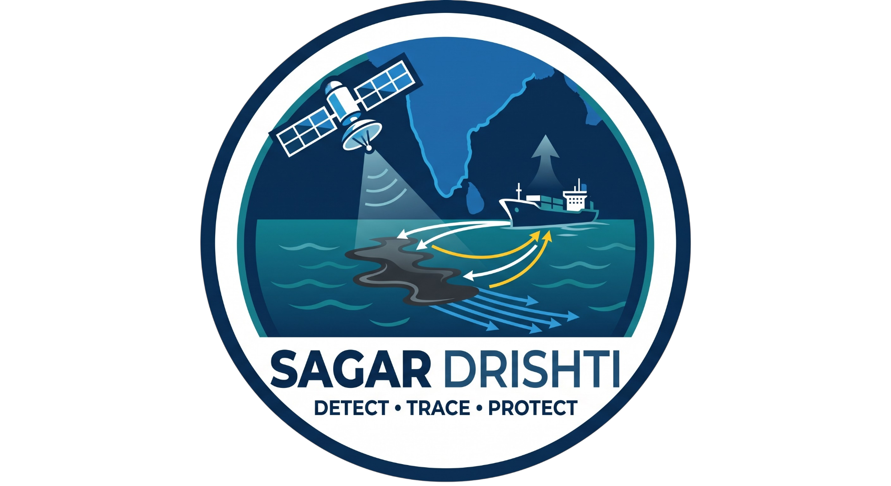
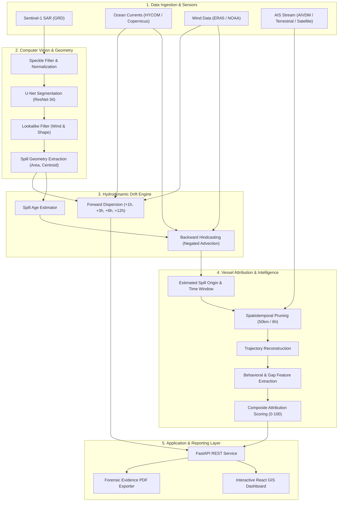

<p align="center">
  
</p>

<h1 align="center">SagarDrishti (सागरदृष्टि)</h1>

<p align="center">
  <strong>Autonomous Satellite-Derived Marine Oil Spill Detection, Hydrodynamic Drift Hindcasting & AIS Vessel Attribution Platform</strong>
</p>

<p align="center">
  
  
  
  
  
  
  
</p>

---

## 📌 Executive Summary

**SagarDrishti** is an integrated maritime intelligence and environmental forensics platform engineered to autonomously detect marine oil slicks from Synthetic Aperture Radar (SAR) imagery, simulate oceanographic Lagrangian drift trajectories, and identify responsible maritime polluters via Automatic Identification System (AIS) spatiotemporal correlation and behavioral anomaly scoring.

Maritime oil pollution—whether resulting from illicit bilge flushing, tanker tank-cleaning, or accidental discharges—causes catastrophic degradation of marine ecosystems and coastal economies. Traditional surveillance mechanisms suffer from high latency, disconnected datasets, and reactive manual verification. SagarDrishti closes this operational gap by linking spaceborne earth observation with surface hydrodynamic modeling and terrestrial/satellite AIS data into a unified, automated, explainable forensic pipeline.

In addition to post-incident attribution, the platform features a continuous **Proactive Risk Surveillance Engine** that geofences marine protected areas (MPAs) and critical navigation channels, monitoring vessels for suspicious deceleration, anomalous heading changes, and deliberate AIS transponder deactivation.

---

## 🔬 Core Capabilities

### 1. High-Precision SAR Detection & Segmentation
- **Sensor Ingestion**: Processes Sentinel-1 C-Band Level-1 Ground Range Detected (GRD) SAR imagery across VV and VH polarizations.
- **Adaptive Despeckling**: Implements Lee and Non-Local Means spatial filtering to suppress coherent speckle noise while preserving slick boundary gradients.
- **Deep Semantic Segmentation**: Employs a fine-tuned U-Net architecture (ResNet-34 backbone) trained on marine slick rasters using a combined loss formulation ($\mathcal{L}_{\text{Dice}} + \mathcal{L}_{\text{BCE}} + \mathcal{L}_{\text{Focal}}$) achieving 72.7% recall on dark slick features.
- **Physics-Informed Lookalike Rejection**: Distinguishes authentic petroleum slicks from biogenic films, internal waves, and wind-shadow lookalikes using ERA5 ocean surface wind thresholds ($3.0\,\text{m/s} \le v_{\text{wind}} \le 12.0\,\text{m/s}$) and morphological compactness metrics.

### 2. Lagrangian Drift Hindcasting & Dispersion Modeling
- **Euler-Lagrangian Advection**: Couples observed slick geometries with ocean surface current vectors ($\vec{u}_{\text{current}}$) and 10-meter wind fields ($\vec{u}_{\text{wind}}$).
- **Physics-Informed Release Age Estimation**: Estimates discharge elapsed time based on plume elongation, perimeter-to-area ratios, and environmental shear forces.
- **Reverse Hindcast Particle Tracking**: Back-propagates hundreds of Lagrangian particles along negated velocity vectors to localize discharge origin coordinates $(\text{Lat}, \text{Lon})$ with dynamic uncertainty radiuses.
- **Forward Trajectory Simulation**: Generates multi-horizon dispersion cones ($+1\text{h}$, $+3\text{h}$, $+6\text{h}$, $+12\text{h}$) to aid containment planning and ecological risk mitigation.

### 3. AIS Trajectory Reconstruction & Spatiotemporal Pruning
- **Spatiotemporal Windowing**: Prunes global and regional AIS message streams to candidates within a dynamic boundary (default: $R \le 50\,\text{km}$, $\Delta T = \pm 6\,\text{hours}$) of the hindcasted release origin and timestamp.
- **Geodesic Path Interpolation**: Reconstructs continuous vessel trajectories from discrete positional pings using Great Circle interpolation.
- **Intersection Testing**: Evaluates LineString proximity against origin uncertainty bounds to isolate potential polluter intercepts.

### 4. Multi-Criteria Explainable Attribution Scoring
- **Composite Attribution Index (0–100)**: Evaluates suspect vessels across six independent operational dimensions:
  1. **Spatial Proximity**: Distance of closest approach relative to the hindcast origin.
  2. **Temporal Alignment**: Proximity of transit to the calculated spill discharge window.
  3. **Track Intersection**: Direct topological intersection with the spill origin envelope.
  4. **Behavioral Anomalies**: Speed variations relative to the vessel's historical median, abrupt course alterations, and mid-voyage stops ($v < 1.0\,\text{knot}$).
  5. **AIS Signal Discontinuity**: Identification of intentional transponder dropouts ("dark gaps" $> 30\,\text{minutes}$) adjacent to the origin.
  6. **Vessel Classification**: Weighting based on cargo capacity, vessel deadweight, and hazardous cargo classifications (e.g., Crude Oil Tanker, Chemical Carrier, Container Ship).
- **Forensic Evidence Generator**: Generates transparent, human-readable evidence summaries for legal and regulatory compliance.

### 5. Proactive Marine Protected Area (MPA) Geofencing
- **Continuous Ingress/Egress Monitoring**: Pre-loaded with eco-sensitive zones and sanctuaries (e.g., Gulf of Kutch, Laccadive Sea, Malvan Marine Sanctuary).
- **Autonomous Watchlist**: Identifies high-risk vessel maneuvers independent of observed spills to enable preventative coast guard dispatch.

---

## 🏛️ System Architecture



---

## 📐 Mathematical & Physical Formulations

### 1. Hydrodynamic Drift Advection Equation
Particle advection combines ocean surface currents, aerodynamic wind drag, and turbulent horizontal diffusion:

$$\frac{d\vec{x}}{dt} = \vec{u}_{\text{current}}(\vec{x}, t) + C_w \cdot \vec{u}_{\text{wind}}(\vec{x}, t) + \vec{u}'_{\text{diffusion}}$$

Where:
- $\vec{u}_{\text{current}}$ is the sea surface current velocity vector ($\text{m/s}$).
- $\vec{u}_{\text{wind}}$ is the 10-meter atmospheric wind velocity vector ($\text{m/s}$).
- $C_w = 0.03$ represents the empirical wind drift coefficient ($3\%$ surface drift factor).
- $\vec{u}'_{\text{diffusion}}$ models stochastic Gaussian turbulent diffusion: $\vec{u}' = \mathcal{N}(0, \sigma^2)$.

During **backward hindcasting**, velocity vectors are negated ($-\frac{d\vec{x}}{dt}$) and integrated from the satellite acquisition timestamp $t_{\text{obs}}$ over the estimated age interval $\Delta t_{\text{age}}$.

### 2. Multi-Criteria Attribution Score Formulation
The composite attribution score $S_{\text{attribution}} \in [0, 100]$ is computed as a linear combination of normalized operational indicators:

$$S_{\text{attribution}} = 100 \times \left( w_1 S_{\text{spatial}} + w_2 S_{\text{temporal}} + w_3 S_{\text{trajectory}} + w_4 S_{\text{behaviour}} + w_5 S_{\text{gap}} + w_6 S_{\text{relevance}} \right)$$

| Dimension | Weight ($w_i$) | Formulation / Criterion |
|---|:---:|---|
| **Spatial Proximity** ($S_{\text{spatial}}$) | $0.30$ | $\max\left(0, 1 - \frac{d_{\text{min}}}{R_{\text{search}}}\right)$ with $R_{\text{search}} = 50\,\text{km}$ |
| **Temporal Proximity** ($S_{\text{temporal}}$) | $0.25$ | $\max\left(0, 1 - \frac{|\Delta t|}{T_{\text{window}}}\right)$ with $T_{\text{window}} = 6.0\,\text{hrs}$ |
| **Trajectory Intersect** ($S_{\text{trajectory}}$) | $0.20$ | $1.0$ if interpolated LineString passes within origin tolerance; else $0.0$ |
| **Behavioral Anomalies** ($S_{\text{behaviour}}$) | $0.10$ | $0.5 \cdot \min\left(1, \frac{\sigma_v}{\bar{v}}\right) + 0.5 \cdot \mathbb{I}(v < 1.0\,\text{knot})$ |
| **AIS Signal Discontinuity** ($S_{\text{gap}}$) | $0.10$ | $1.0$ if AIS blackout $> 30\,\text{min}$ recorded near origin; else $0.0$ |
| **Vessel Classification** ($S_{\text{relevance}}$) | $0.05$ | $1.0$ (Tanker/Chemical), $0.7$ (Cargo/Container), $0.4$ (Tug/Other) |

---

## 🗂️ Project Repository Layout

```text
SagarDrishti/
├── assets/
│   └── logo.png                        # Official SagarDrishti emblem
├── config/
│   └── config.yaml                     # Pipeline parameters, weights, and thresholds
├── data/
│   ├── raw/                            # Ingested NetCDF currents, wind, SAR rasters, and AIS data
│   └── sample_assets/                  # Benchmark preview and verification datasets
├── dashboard/
│   ├── app.py                          # Streamlit reference dashboard interface
│   └── components/                     # Map and metrics view components
├── frontend/
│   ├── public/                         # Public web assets and icons
│   ├── src/
│   │   ├── components/                 # React UI tabs (Forensic, Proactive, Sandbox, GISMap)
│   │   ├── App.jsx                     # Application root and state router
│   │   └── index.css                   # Global styles and Tailwind tokens
│   ├── package.json                    # Frontend dependencies and build scripts
│   └── vite.config.js                  # Vite bundler configuration
├── models/
│   ├── spill_unet.pth                  # Pre-trained U-Net segmentation weights
│   └── checkpoints/                    # Training intermediate checkpoints
├── src/
│   ├── age_estimation/                 # Spill age estimation based on physical geometry
│   ├── ais/                            # Trajectory reconstruction & anomaly detection
│   ├── api/
│   │   └── main.py                     # High-performance FastAPI application
│   ├── data/
│   │   ├── loaders.py                  # Geotiff & NetCDF raster loaders with safe fallbacks
│   │   ├── schema.py                   # Strict data contracts and schemas
│   │   └── synthetic_ais.py            # AIS generation utility for zero-data environments
│   ├── detection/
│   │   ├── lookalike_filter.py         # Meteorological & morphological false-positive filtering
│   │   ├── preprocess.py               # SAR calibration and despeckling
│   │   ├── segmentation_model.py       # PyTorch U-Net inference pipeline
│   │   └── spill_geometry.py           # Geodesic area, perimeter, and centroid metrics
│   ├── drift/
│   │   ├── backward_hindcast.py        # Reverse Lagrangian particle advection
│   │   ├── forward_simulation.py       # Forward dispersion forecasting engine
│   │   └── particle_model.py           # Rejection-sampling particle cloud initialization
│   ├── pipeline/
│   │   ├── run_pipeline.py             # CLI orchestrator connecting all system stages
│   │   └── monitor.py                  # Automated directory watcher and trigger
│   ├── scoring/
│   │   ├── proactive_risk.py           # Geofenced risk scoring for sensitive sanctuaries
│   │   └── suspect_scoring.py          # Multi-criteria vessel attribution algorithms
│   └── utils/
│       └── geo_utils.py                # Geodesic distance, coordinate conversion, and bounds
├── tests/
│   └── test_pipeline.py                # End-to-end integration and unit test suite
├── requirements.txt                    # Python environment specifications
├── start_demo.bat                      # One-click Windows deployment launcher
└── README.md                           # Master system documentation
```

---

## ⚡ Installation & Setup

### Prerequisites
- **Python**: Version 3.10 or higher
- **Node.js**: Version 18.0 or higher (for the React Dashboard)
- **GDAL / Geospatial Libraries**: Standard system dependencies for rasterio and shapely

### 1. Clone the Repository
```bash
git clone https://github.com/PalakGoyal6/sagardrishti.git
cd sagardrishti
```

### 2. Backend Environment Configuration
Create and activate an isolated Python virtual environment:

```bash
# On Linux / macOS:
python3 -m venv .venv
source .venv/bin/activate

# On Windows:
python -m venv .venv
.venv\Scripts\activate
```

Install the backend dependencies:
```bash
pip install -r requirements.txt
```

### 3. Frontend Environment Configuration
Install Node.js packages for the modern web dashboard:
```bash
cd frontend
npm install
cd ..
```

---

## 🚀 Execution & Operational Modes

### Option A: Unified One-Click Launcher (Windows)
To concurrently launch both the FastAPI backend server and the React frontend dashboard:
```cmd
start_demo.bat
```
- **Interactive UI**: `http://localhost:5173`
- **Swagger API Docs**: `http://127.0.0.1:8000/docs`

---

### Option B: Manual Service Execution

#### 1. Launch FastAPI Backend Service
```bash
python -m uvicorn src.api.main:app --host 127.0.0.1 --port 8000 --reload
```

#### 2. Launch React GIS Dashboard
In a separate terminal window:
```bash
cd frontend
npm run dev
```

#### 3. Launch Alternative Lightweight Streamlit Dashboard
```bash
python -m dashboard.app
```

---

### Option C: Standalone Command-Line Pipeline

#### Run in Demonstration / Mock Mode (Zero-data verification)
The pipeline features automated synthetic generators allowing complete end-to-end execution without requiring external satellite raster downloads:
```bash
python -m src.pipeline.run_pipeline --mock
```

#### Run on Real SAR Satellite Imagery
```bash
python -m src.pipeline.run_pipeline --image data/raw/sentinel1_sample.tif
```

---

## 🌐 RESTful API Reference

The FastAPI service exposes high-throughput endpoints for integration into national Vessel Traffic Management Systems (VTMS):

| Method | Endpoint | Description |
|---|---|---|
| `GET` | `/api/health` | Service health status, system uptime, and model availability. |
| `GET` | `/api/dataset/categories` | Catalog of available satellite scenes and preloaded cases. |
| `GET` | `/api/sar_preview` | Base64-encoded SAR image preview and ground-truth mask overlays. |
| `POST` | `/api/analyze` | Executes detection, drift hindcast, and vessel attribution for a selected scene. |
| `GET` | `/api/proactive_watchlist` | Fetches active vessels currently inside designated Marine Protected Areas with risk metrics. |
| `POST` | `/api/simulate_drift` | Interactive sandbox endpoint running forward/backward Euler advection for arbitrary coordinates. |
| `POST` | `/api/export_report` | Generates and streams a formal forensic evidence PDF report for the analyzed incident. |

---

## 🧪 Testing & Validation

The platform includes a rigorous test suite validating computer vision models, lookalike filters, particle advection physics, and suspect ranking algorithms.

Execute the integration test suite:
```bash
python -m pytest tests/test_pipeline.py -v
```

Execute precision and recall verification:
```bash
python check_precision.py
```

---

## ⚙️ Configuration Specification

System behavior is controlled through [config/config.yaml](file:///d:/SagarDrishti/config/config.yaml):

```yaml
pipeline:
  name: SagarDrishti Oil Spill Detection & Attribution
  fallback_mode: true

detection:
  confidence_threshold: 0.2
  speckle_filter_kernel: 5
  min_spill_area_km2: 0.1
  checkpoint_path: models/spill_unet.pth

drift:
  n_particles: 500
  wind_drift_factor: 0.03
  hindcast_hours: [1, 3, 6]
  forecast_hours: [1, 3, 6, 12]
  time_step_minutes: 15

ais:
  search_radius_km: 50.0
  time_window_hours: 6.0
  trajectory_tolerance_km: 5.0
  gap_threshold_minutes: 30

scoring:
  weights:
    spatial: 0.30
    temporal: 0.25
    trajectory: 0.20
    behaviour: 0.10
    ais_anomaly: 0.10
    vessel_relevance: 0.05
```

---

## 🛰️ Data Attribution & Standards

- **Satellite Remote Sensing**: Synthetic Aperture Radar data processed in accordance with Copernicus Sentinel-1 Observation and Scientific Data guidelines.
- **Ocean Dynamics**: Compatible with HYCOM (Hybrid Coordinate Ocean Model) and Copernicus Marine Environment Monitoring Service (CMEMS) NetCDF formats.
- **Atmospheric Modeling**: Atmospheric wind velocity vectors derived from ECMWF ERA5 reanalysis datasets.
- **Maritime Regulatory Standards**: Formatted to assist enforcement bodies in fulfilling MARPOL 73/78 (Annex I: Prevention of Pollution by Oil) reporting mandates.

---

## 📄 License

This project is licensed under the **MIT License**. See the `LICENSE` file for full terms.
